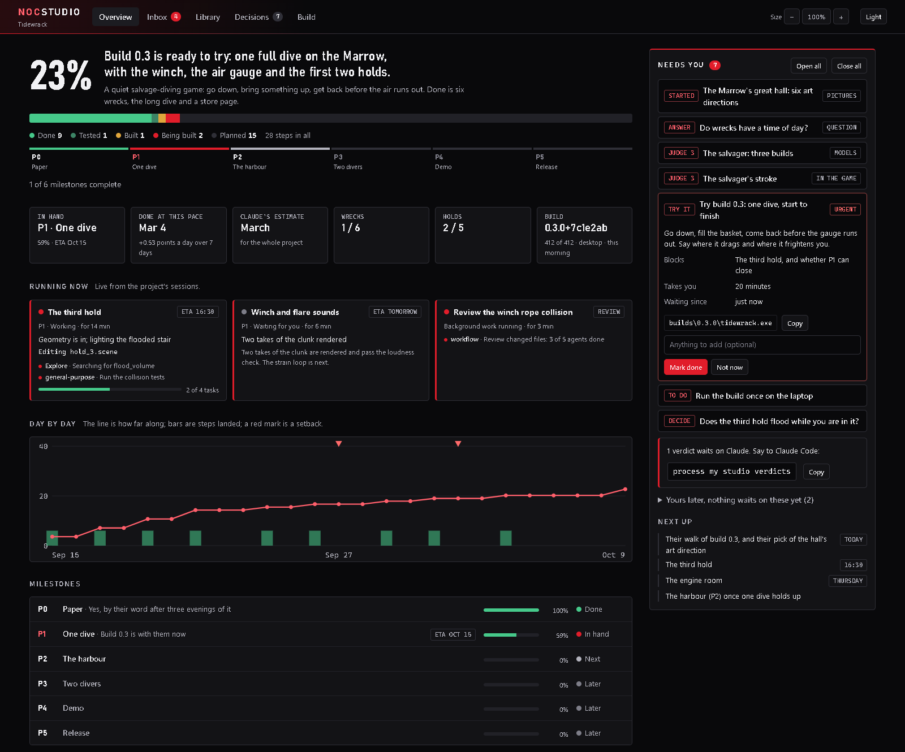
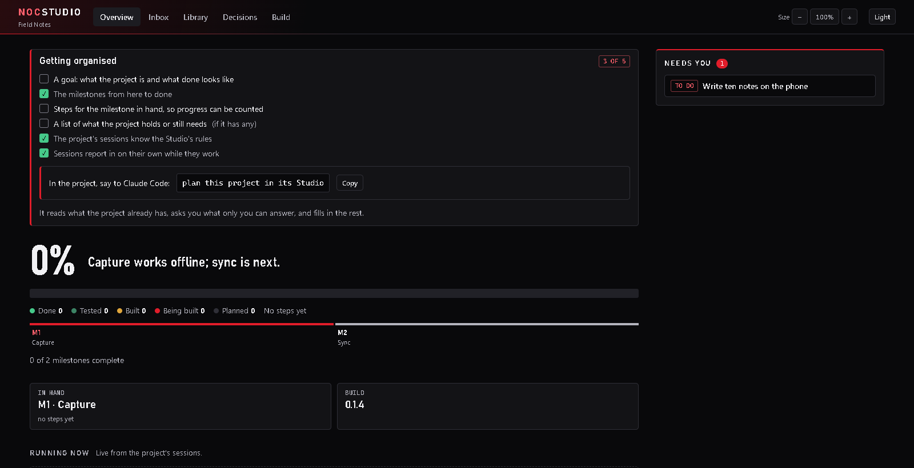
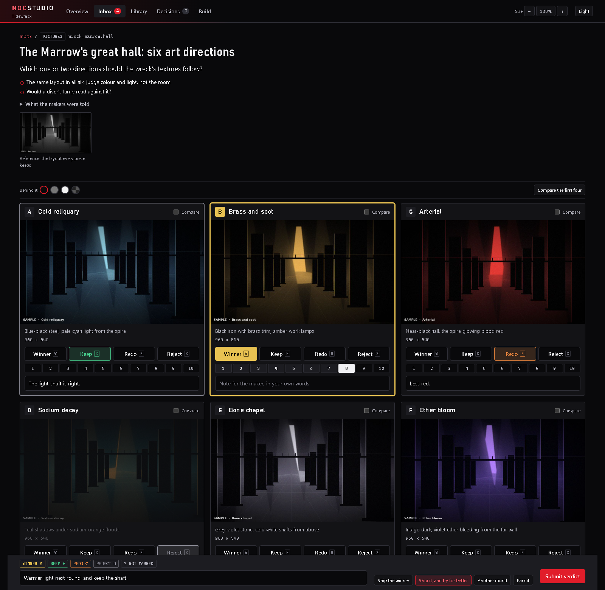
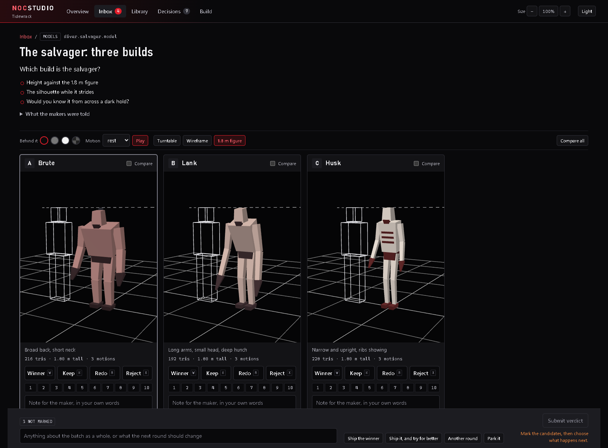
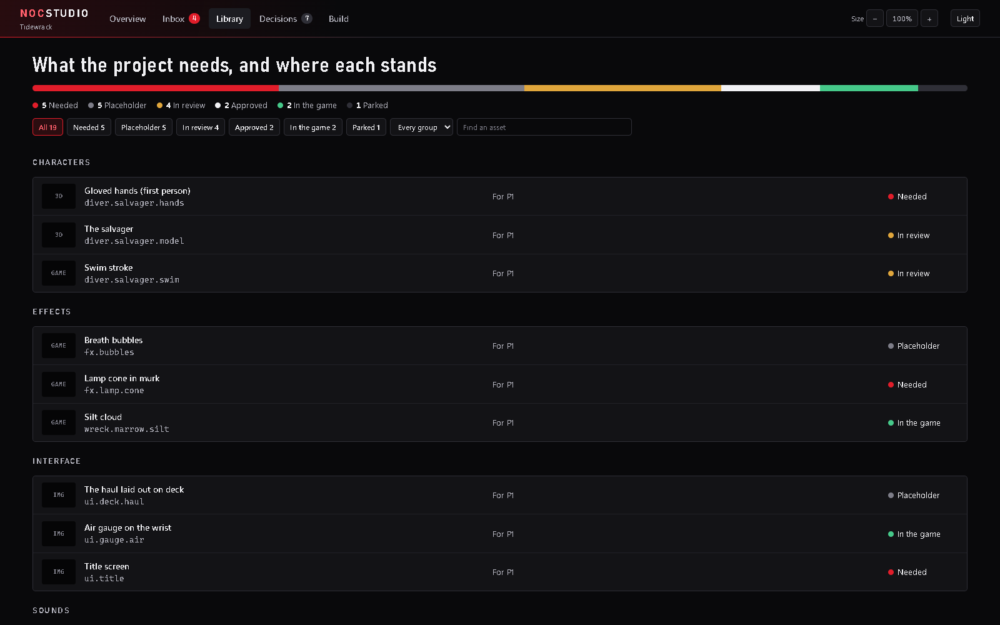
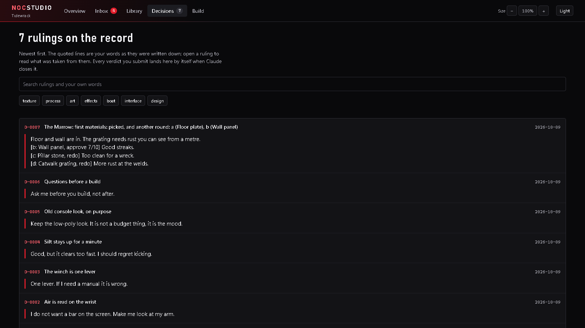
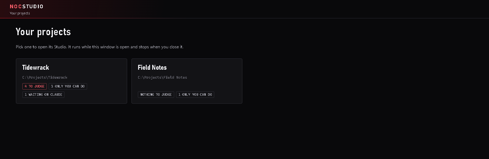
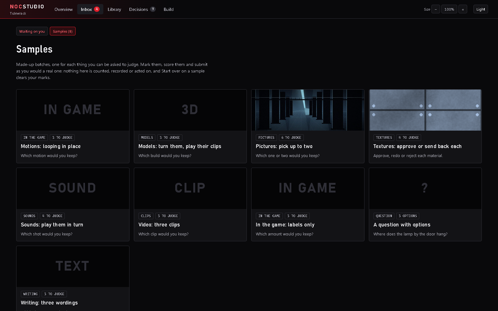
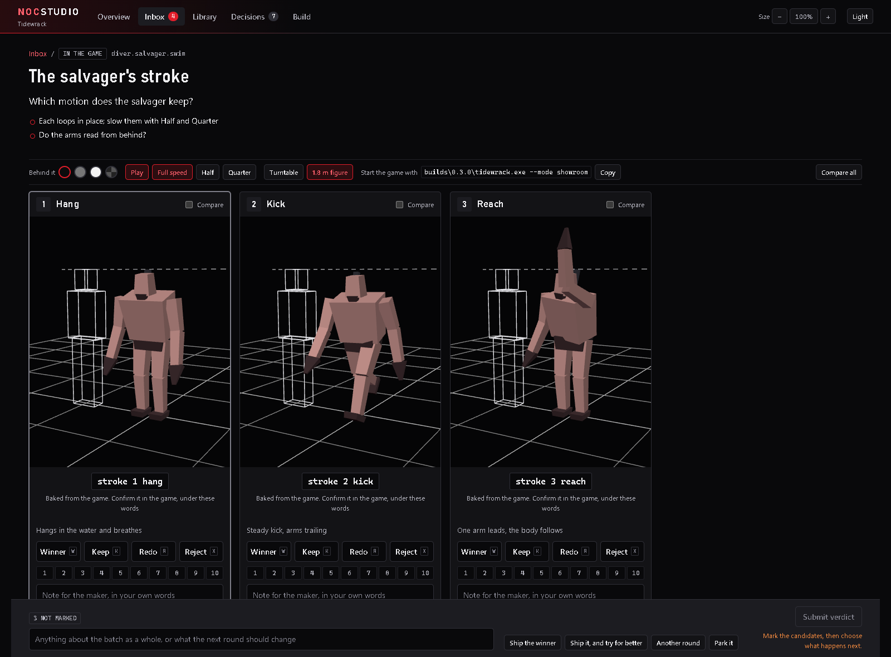
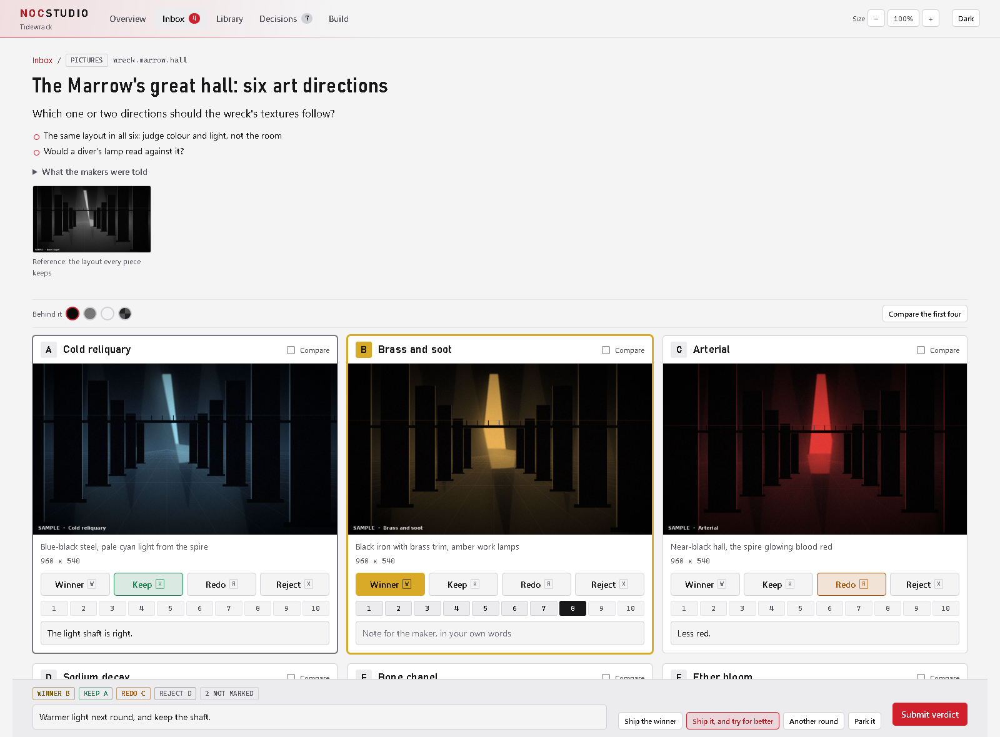

<div align="center">

# NocStudio

**A local project hub for work you build with AI coding agents.**

See how far along the project is and what every session is doing right now, judge what the
agent made, and keep every ruling you give it, in one window on your own machine.



</div>

---

When an agent like Claude Code builds a project with you, the code is the easy part to review.
Everything else piles up in chat: six candidate pictures in a folder, "which of these two sounds
do you prefer?", a decision you made three weeks ago that the next session has never heard of,
and a growing list of things only you can do.

NocStudio gives all of that one place. The agent keeps a **board** you look at instead of asking
for a status update. It **files** what you must judge, and you **judge** it in a page built for
looking, listening and comparing. Nothing happens until you say **"process my studio
verdicts"**, and then the agent acts on exactly what you marked, in your words.

It is a small Python program and a folder of plain files. No account, no cloud, no packages to
install, and nothing leaves your machine.

## What you get

### An overview you look at instead of asking

The first page is a live board:

- **One number for the whole project.** Each milestone is broken into steps, and the percentage
  is counted from where each step stands (planned, being built, built, tested, done). Nobody
  types it.
- **Running now.** Claude Code's hooks report what every session in the project is doing as it
  happens: working or waiting for you, the last thing it did, which subagents and background
  workflows are running, how many of its tasks are done. The agent adds what each piece of work
  is and when it should land.
- **Day by day.** A chart of progress per day, with bars for steps landed and a red mark on days
  with a setback, and the date the project is done if the last week's pace holds.
- **Milestones and a log.** Each milestone with its bar, its ETA and its steps; merges, publishes
  and setbacks in a log, newest first.
- **Needs you.** A rail of everything that waits on you: batches to judge, builds to try, chores
  only you can do, and questions only you can answer. Each ask says what it blocks and **what
  the agent will do if you say nothing**, so work does not stop while you are away.

### Organised from the start

Say **"start a new project"** or **"plan this project in its Studio"** to Claude Code. It reads
what the project already has, drafts the goal, the milestones and the steps of the first one,
asks you only what you alone can answer, and writes the plan in. A Studio that has not been
planned yet says so on its Overview, with a checklist of what is missing.



### An inbox built for judging

Each batch is one decision with up to six candidates. Mark a **Winner**, **Keep** a direction,
send one back to **Redo** with a note, or **Reject** it; score them 1 to 10; then choose what
happens next (ship it, ship it and try for better, another round, park it).



The page knows how to show each kind of work:

| Kind | What the page does |
|---|---|
| Pictures | Zoom and pan, compare up to four side by side with linked zoom, a reference shown above |
| Textures | Tile them at any size to see the repeat |
| 3D models | Turn, zoom, wireframe, a 1.8 m reference figure, play the clips the model carries |
| Motions | Each candidate loops in place in the 3D viewer, at full, half or quarter speed |
| Sounds | Waveform, length and peak level, play them in turn, loop one |
| Video | Looping clips side by side |
| In-app options | Labels to look for in the running app, with the line that starts it |
| Questions | Options written out with what each costs, risks and feels like |
| Writing | Short texts shown as written |



Before a batch reaches you, **checks** run on every file (too loud, too long, too many
triangles, wrong size, no record of how it was made). A batch that breaks a rule is held back
and the agent is told why, so you never spend a minute on something a script could refuse.

### A library of everything the project holds or needs

Every asset has a status: needed, placeholder, in review, approved, in the game, parked. Open one to
see or hear the approved master, what the project uses today, and the history of how it got
there, with where each file came from (tool, prompt, seed, script).



### A record of every ruling

Each verdict becomes a numbered decision with your notes quoted exactly. Rulings you make in
chat or in a playtest go on the same log. A new decision can supersede an old one; nothing is
erased. The next session can read what you already settled instead of asking again.



### One window for every project

`NocStudio` in the Start menu opens a menu of every project that has a Studio. Pick one and it
starts and opens there; close the window and it stops. Nothing runs in between.



### Samples to try it on

Every Studio comes with made-up batches, one for each kind of work, so you can try the whole
flow before your project has filed anything. Nothing in a sample is counted or acted on.



### Dark and light, at your size

<p>


</p>

## Quick start

You need Windows 10 or 11, [Python 3.11 or newer](https://www.python.org/downloads/) (with the
`py` launcher), git, and Edge or Chrome. Nothing else is installed.

```
git clone https://github.com/Noctuem/NocStudio.git
cd NocStudio
py -3.11 tool\selftest.py
py -3.11 tool\studio.py install-skill
py -3.11 tool\studio.py hooks install
py -3.11 tool\studio.py app --install
```

Then, in your project, say to Claude Code: **set up a studio for this project**. Open
**NocStudio** from the Start menu, pick the project, and try **Inbox → Samples** while it works.

The full walk-through, including how to teach your agent to use it, is in
[docs/QUICKSTART.md](docs/QUICKSTART.md).

## How it works with your agent

`create` puts a **skill** in your project (`.claude/skills/studio/SKILL.md`) that teaches Claude
Code the rules:

1. Anything you must judge is filed as a batch. The agent never asks you to open a folder or
   pick in chat.
2. One batch, one decision, six candidates at most.
3. You only see what passes the checks.
4. Nothing happens on a verdict until you say so.
5. Your words are quoted, never paraphrased.
6. The board is kept true as work happens: a step moves, work starts or lands, a merge, a
   publish, a setback.
7. Every question for you goes in Needs you with the default the agent will use. It does not
   stop and wait unless nothing can go on without your answer.

The agent works through one command (`studio.py new`, `add`, `file`, `todo`, `done`, `decide`,
`step`, `lane`, `log`, `ask`, `save`, and a few more). Claude Code's hooks report session
activity on their own: `studio.py hooks install` adds them to your own Claude Code settings
(keeping a copy from before), they only watch, and a project without a Studio is left alone. You work in the page. Between you is a folder of JSON and media files
that either side can read, and that lives in its own git repository so the history of what you
judged is kept.

The skill is plain markdown, so other agents that can run a command and follow written
instructions can use it too. It has only been used with Claude Code.

## What it is made of

- **Python 3.11, standard library only.** The server, the checks, the 3D motion baker, the
  session hook and the app launcher have no dependencies.
- **One page of plain JavaScript and CSS.** No build step. [three.js](https://threejs.org) is
  vendored for the 3D viewer.
- **Plain files.** A Studio home is folders of JSON, markdown and your media. You can read it,
  diff it and back it up like anything else.
- **Local only.** The server listens on `127.0.0.1` and refuses requests from anywhere else.

```
tool/             the program: studio.py (the command), hook.py (what Claude Code's hooks run),
                  studiolib/ (the server and store), web/ (the page),
                  samples_src/ (placeholder files for the Samples), selftest.py
claude/templates/ the skill and the CLAUDE.md section each project gets
docs/             the quick start and the screenshots
```

## Status

NocStudio was built for one game project and is in daily use there. It is young. Expect rough
edges, and expect it to change.

- **Windows first.** The Start menu app and the launchers are Windows only. The page and the
  command are plain Python and may run elsewhere with `python3 tool/studio.py serve`, but that
  is untested.
- **Game-shaped.** The vocabulary (models, textures, motions, playtests, "in the game") comes
  from game development. Pictures, sounds, writing and questions work for any project.
- **One person.** A Studio is for one person judging and one machine. There are no accounts and
  no sharing.

`py -3.11 tool\selftest.py` exercises the whole thing in a temp folder and prints one line per
step. Run it after any change.

## License

[MIT](LICENSE). three.js is vendored under its own MIT license (`tool/web/vendor/THREE-LICENSE.txt`).

NocStudio was written with [Claude Code](https://claude.com/claude-code).
